# teaching.ezznasr.dev

The teaching portal for Eng. Ezz Nasr's courses (programming, math, English): lessons, videos, quizzes and homework for
students, and a set of staff pages for the owner, teachers and assistants to follow students up, grade, manage access,
manage the team and see revenue.

All screenshots use **sample data** (`?mock=1` mode or test fixtures). No real student appears in this repo.

| | |
|---|---|
| 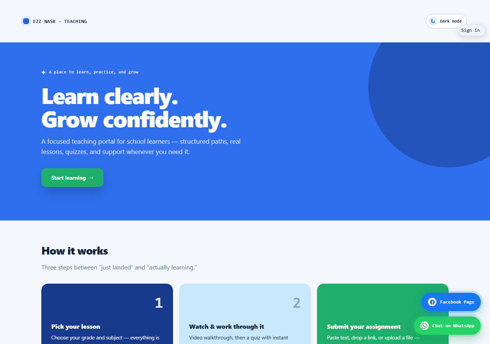 | 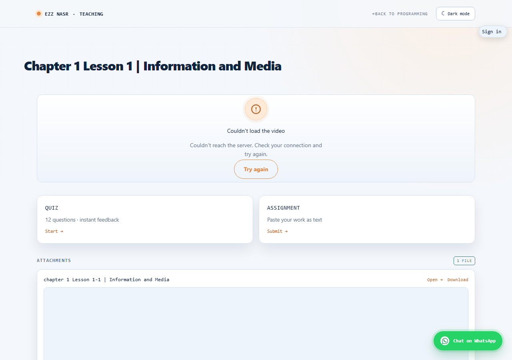 |

---

## Contents

- [How it is built](#how-it-is-built)
- [For students](#for-students)
- [Staff pages](#staff-pages)
  - [Results](#results-the-main-dashboard) · [Lesson access, groups and payments](#lesson-access-groups-and-payments)
  - [Follow-up](#follow-up-المتابعة) · [Monthly report and requirements](#monthly-report-and-requirements-المطلوبات)
  - [Student summary](#student-summary-ملخص-الطالب) · [Grading](#grading-التصحيح)
  - [Team](#team-الفريق) · [Revenue](#revenue-الإيرادات) · [Teacher's own team](#a-teachers-own-team-فريقي)
- [Attendance](#attendance) · [WhatsApp sender](#whatsapp-sender) · [Quiz Maker](#quiz-maker-desktop-app)
- [Who can see what](#who-can-see-what) · [Tests](#tests) · [Deploying](#deploying) · [More docs](#more-docs)

---

## How it is built

| System | What | Where it runs | How a change goes live |
|---|---|---|---|
| **Site** | Static HTML / CSS / JS, no framework | GitHub Pages from `main` (`tools/` is not published) | `git push` |
| **Backend** | Google Apps Script web app with Google Sheets as the database, Drive for files, Telegram for notifications | script.google.com, one deployment, one `/exec` URL | paste the changed `.gs` files, then **Deploy > Manage deployments > Edit > New version** |
| **Quiz Maker** | Desktop app that builds lesson pages, quizzes and answer keys | the owner's computer (`tools/quiz-maker-v2/`) | run it, then push what it made |

The Apps Script project has eight files, all in `tools/quiz-maker-v2/apps_script/`:
`Code.gs`, `AttendanceAll.gs`, `FollowupRouter.gs`, `FollowupNotify.gs`, `Requirements.gs`, `FollowupLogic.gs`,
`FollowupWhatsApp.gs` and `Revenue.gs`. (`chunks/*.gs` are already merged into `Code.gs`.)

Principles that every feature follows (details in [docs/ARCHITECTURE.md](docs/ARCHITECTURE.md)): the server decides who may
do what; every write is safe to repeat; plain words in the user's language on screen (staff pages are Egyptian Arabic,
right to left); every value from the server is shown as text, never as HTML.

---

## For students

| | |
|---|---|
| 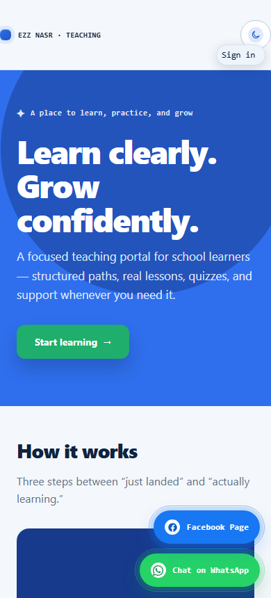 | 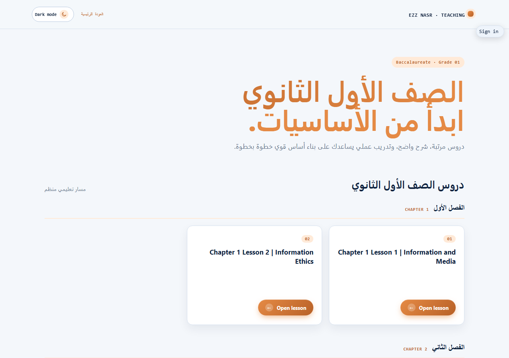 |

- **Lessons by subject and grade**: programming (Baccalaureate grade 1 and 2 secondary, plus short courses), math, English.
- **Each lesson** has its videos, a quiz (`quiz.html`) and an assignment (`assignment.html`), with attachments and math rendering.
- **Videos are locked** until the student has access. A student pays by bank / wallet transfer and presses "I paid" with the
  transfer reference, for **one lesson**, a **chapter** or a whole **term** (chapter and term subscriptions have fixed prices).
  The owner (or the subject's teacher) approves it on the access page or straight from Telegram.
- **Quizzes** are marked at once; **written answers** are uploaded as photos (with an upload check that the photo really arrived)
  and graded by staff.
- **Student dashboard** (`dashboard/student.html`): results, what is still due, wrong questions to review.
- **Sign in** with phone number and password; one active device per account.

---

## Staff pages

Every staff page has the same Arabic menu: النتايج · الوصول للدروس · المتابعة · المطلوبات · التصحيح · الفريق · الإيرادات.
Each page also opens in **mock mode** (`?mock=1`) with sample data and saves nothing, which is how the screenshots were taken
and how the browser tests run.

**Arabic / English.** Staff pages have a language button next to the dark-mode button (`EN` / `ع`). Arabic is the default;
one tap switches the page to English (left to right) without a reload and without losing anything typed, and the choice is
remembered on that device for every staff page. Names, group names, lesson titles and messages to parents stay in their own
language. Done so far: Team, Revenue and the assistant's home page (`staff.html`); the other staff pages follow. How it works:
`assets/i18n.js` (shared) plus one word list per page in `assets/i18n/`. Test: R-I18N-1.

| Arabic (default) | English |
|---|---|
| 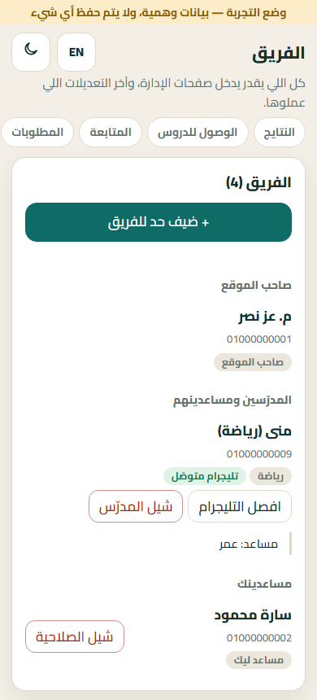 | 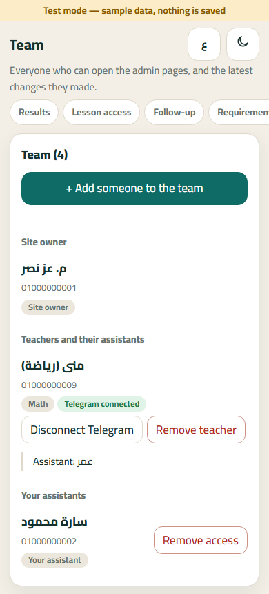 |
| 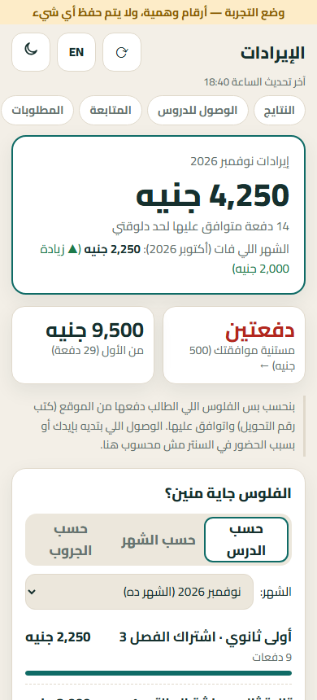 | 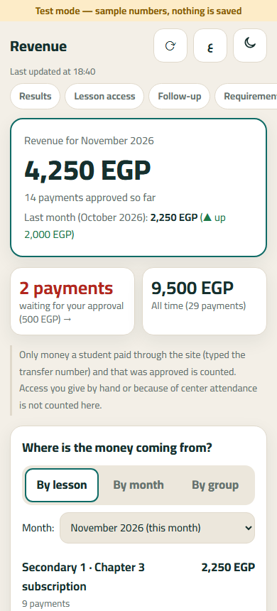 |

### Results (the main dashboard)
`dashboard/master.html`: every student's quiz and homework results, filters by grade, group and lesson, wrong-question analysis
(`dashboard/wrong-questions.html`). Teachers see only their own subjects.

### Lesson access, groups and payments
`dashboard/access.html`: who can open which lesson and until when; payment requests waiting for approval (approve with the
lesson / chapter / term and how long, or reject); payment history; give or take access by hand (cash, scholarship) for a student
or a whole group; quiz locks; groups and their students.

### Follow-up «المتابعة»
`dashboard/followup.html`, built for a phone. Per group: today's lesson, attendance, missing homework and quizzes, and one tap
to message a parent on WhatsApp with a ready-made message. A walk-through mode goes student by student. Message templates are
editable. The monthly report and a monthly mass send to parents (test mode by default) are here too.

| | |
|---|---|
| 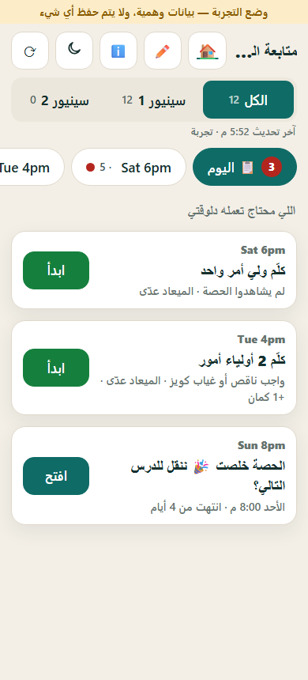 | 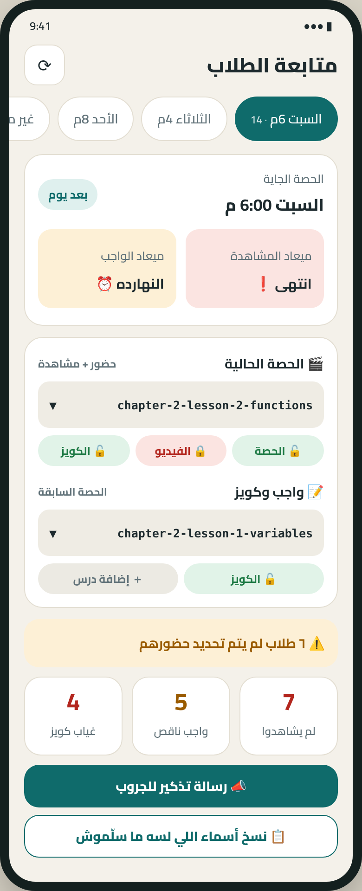 |
| 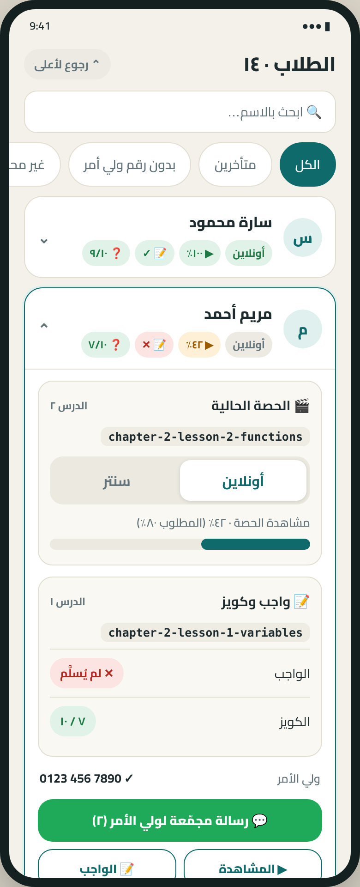 | 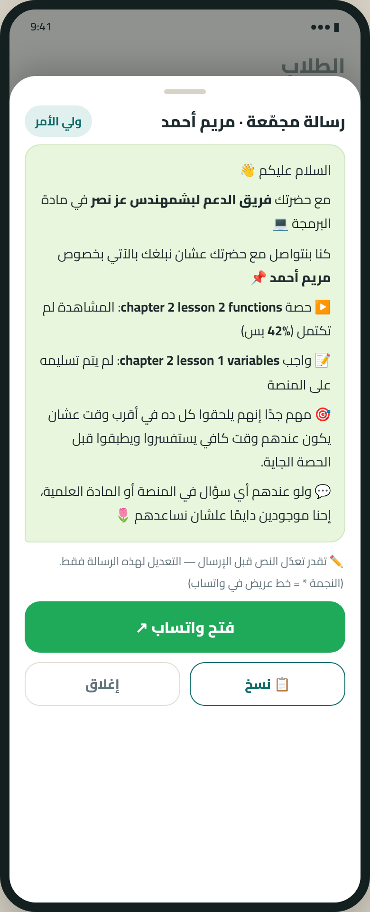 |

### Monthly report and requirements «المطلوبات»
`dashboard/requirements.html`: what counts in the follow-up and the monthly report (watching the video, homework, quiz,
attendance, written answers, plus your own items), switched on or off for everyone or per group, and the lessons required
each month.

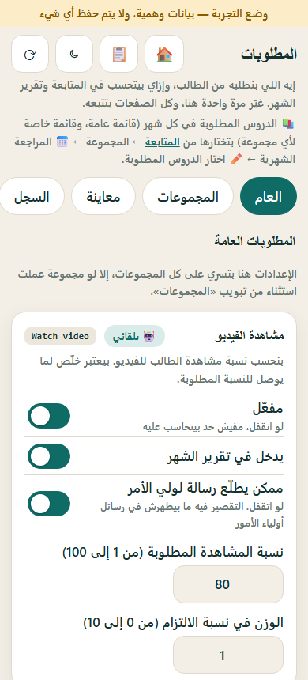

### Student summary «ملخص الطالب»
`dashboard/student-summary.html`: one student's attendance, homework, quizzes, parent contacts and monthly status on one screen.
Teachers can correct a student's name or phone here.

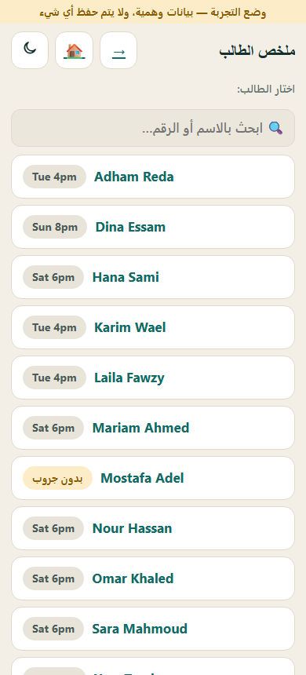

### Grading «التصحيح»
`dashboard/grading.html`: written answers waiting for marks. Photo next to the model answer, rotate / zoom, marks, next. Marks
are staged and saved together.

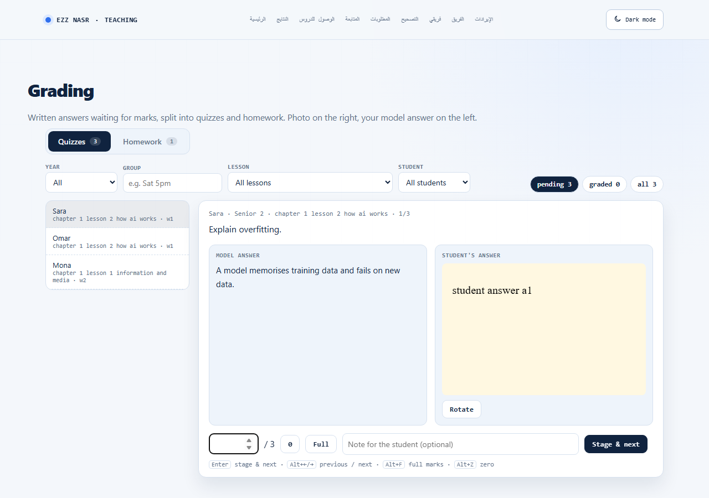

### Team «الفريق»
`dashboard/team.html` (owner only). One list of everyone who can sign in as staff: the owner, the teachers (their subjects,
whether their Telegram is linked, and their assistants under them) and the owner's own assistants. One
**«+ ضيف حد للفريق»** button adds an assistant, or a teacher with their subjects. **«آخر التعديلات»** shows what teachers and
assistants changed (names, phones, attendance, grades, requirements, follow-up steps) in plain words. What an assistant can
and can't do is folded at the bottom.

| Before (Nov 2026) | After |
|---|---|
| 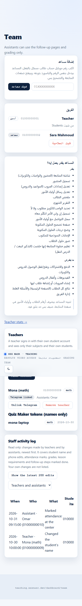 | 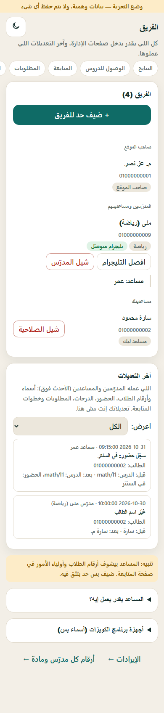 |

### Revenue «الإيرادات»
`dashboard/revenue.html` (owner only).

- **Only money paid through the website counts**: a student pressed "I paid", typed the transfer number, and the payment was
  approved. Access given by hand, to a group, or for attending at the center is never revenue. Rejected and revoked payments
  don't count; payments waiting for approval are shown apart.
- **Main view**: this month's revenue next to last month's, what is waiting for approval, and the all-time total.
- **«الفلوس جاية منين؟»**: by lesson / chapter / term, by month, or by group, for any month.
- **Lesson price**: set once on the page; every new single-lesson payment is saved with that price. Old lesson payments with no
  amount can be filled in **once** at today's price («احسبهم بسعر النهارده»); subscriptions are never touched, and a later
  price change does not move payments already saved.
- Per-teacher and per-subject numbers are one link away (`dashboard/teacher-stats.html`).

| Phone | Desktop |
|---|---|
| 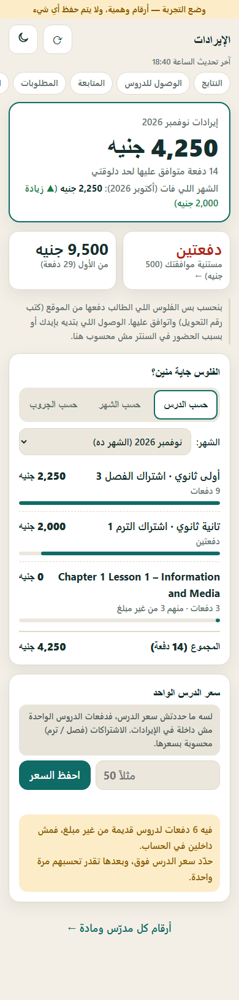 | 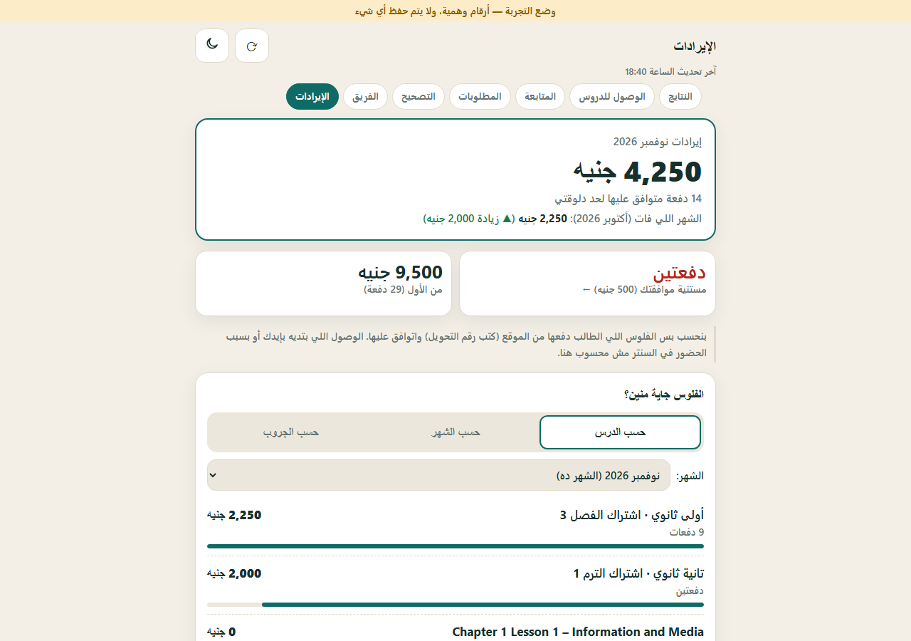 |

### A teacher's own team «فريقي»
`dashboard/my-team.html` (teachers): appoint up to three assistants for their own students, and link Telegram to receive and
decide payment requests for their subjects.

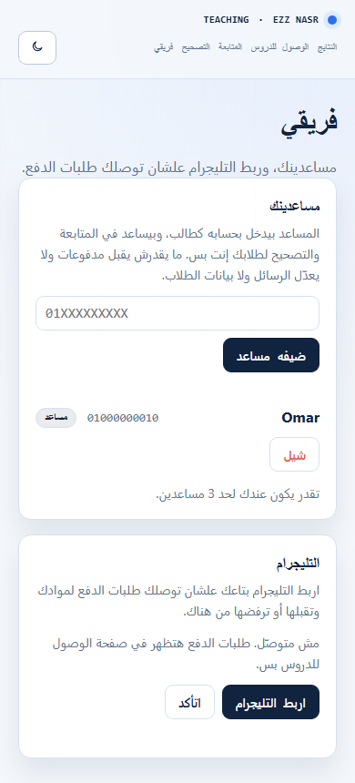

---

## Attendance

`attend/`: students check in at the center by scanning a QR code on the room screen; the device, location and time are
checked. Teachers see who is in, flags that need a look, and can mark someone by hand. It has its own Telegram bot.
Full docs: [docs/attendance/](docs/attendance/README.md).

| | | |
|---|---|---|
| 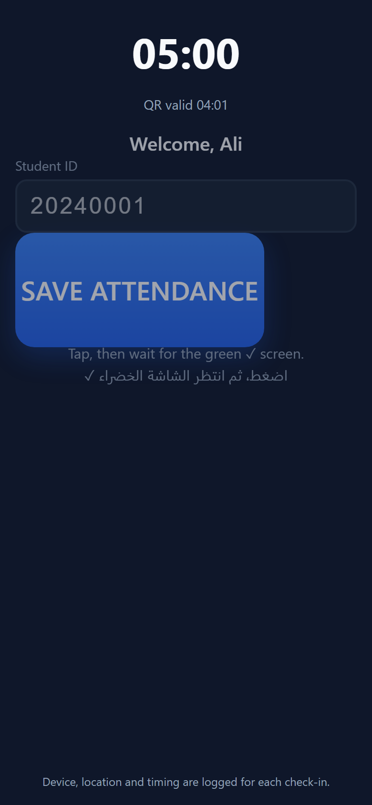 | 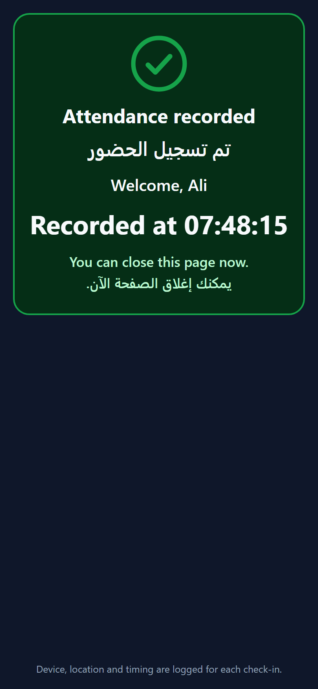 | 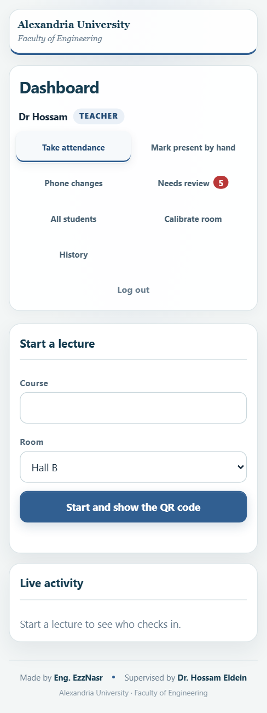 |

---

## WhatsApp sender

A spare Android phone sends the follow-up messages to parents from the main number: staff queue a message on the follow-up
page, the phone picks it up, sends it and reports back. Test mode sends everything to one test number. Docs:
[docs/whatsapp/](docs/whatsapp/README.md).

| | | |
|---|---|---|
| 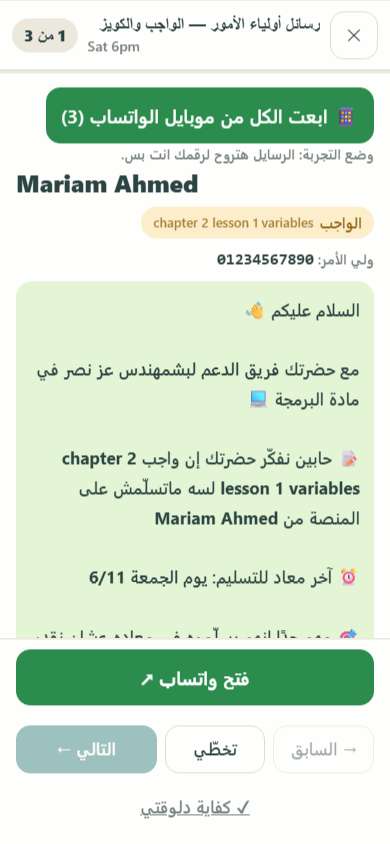 | 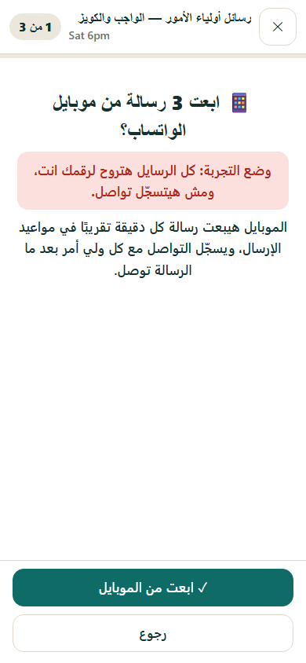 | 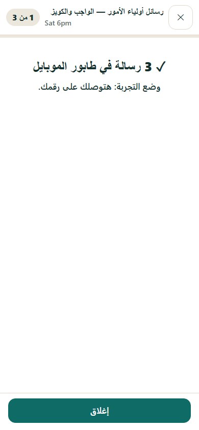 |

---

## Quiz Maker (desktop app)

`tools/quiz-maker-v2/`: a local app that turns a lesson's content into the lesson page, its quiz and its answer key, uploads
videos and model answers to the backend, and keeps lesson ids consistent. See its [README](tools/quiz-maker-v2/README.md).

---

## Who can see what

| Page | Owner | Teacher | Teacher's assistant | Owner's assistant |
|---|:-:|:-:|:-:|:-:|
| Results, lesson access | yes | own subjects | own teacher's subjects, no payments | |
| Follow-up, student summary, grading | yes | own students | own teacher's students | yes |
| Requirements | yes | | | yes |
| Team, revenue, teacher stats, wrong questions | yes | | | |
| My team | | yes | | |

The page only hides what you can't use; the server checks every request again (`assets/staff-guard.js` on the page,
`P4_ACTIONS` in `Code.gs` on the server).

---

## Tests

One gate, from the repo root:

```bash
PYTHONIOENCODING=utf-8 bash scripts/test_all.sh --e2e
```

- Backend logic runs in Node against the real `.gs` files; pages run in a small fake DOM; browser tests drive real Chromium
  (Playwright) against `?mock=1` pages.
- Every test is registered in `tools/quiz-maker-v2/tests/registry.json`; [docs/REGRESSION.md](docs/REGRESSION.md) is generated
  from it (`python scripts/gen_regression_table.py`).
- GitHub Actions runs the same gate on every push.

---

## Deploying

**Backend first, then the site** (a new page calling an old backend gets "unknown action"; an old page keeps working).

1. Apps Script editor: replace each changed `.gs` file with the repo file (add new files such as `Revenue.gs`), save,
   **Deploy > Manage deployments > Edit > New version**. Never "New deployment": it changes the URL the site uses.
2. Compare every file in the editor with the repo before deploying, and write the version number and commit in the deploy log
   ([docs/attendance/decisions.md](docs/attendance/decisions.md)) with the rollback version.
3. `git push` to `main`; GitHub Pages publishes in a few minutes.

---

## More docs

[docs/README.md](docs/README.md) is the map: architecture, testing, the data contract, runbooks, specs (for example the
[admin pages plan](docs/specs/admin-ux-plan.md)), attendance and WhatsApp.
