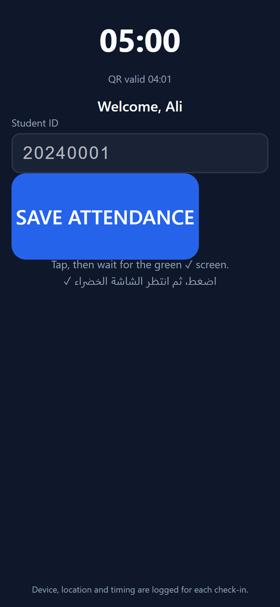
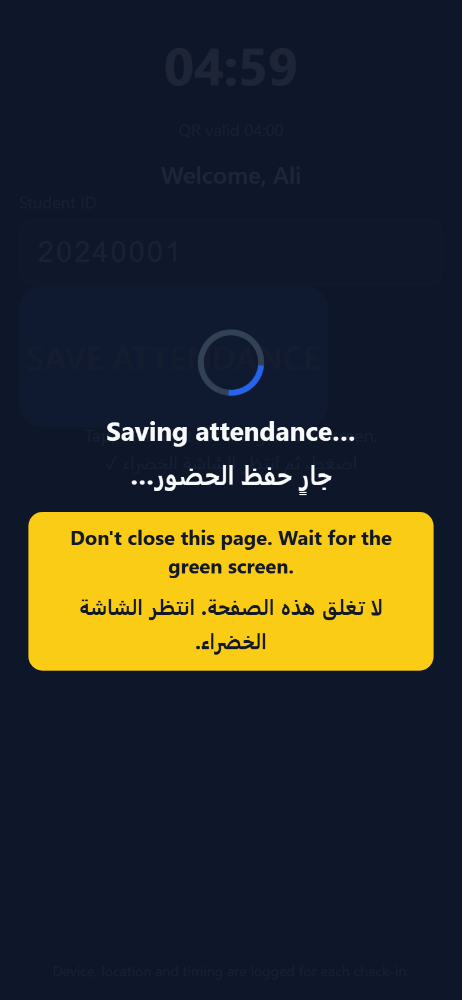
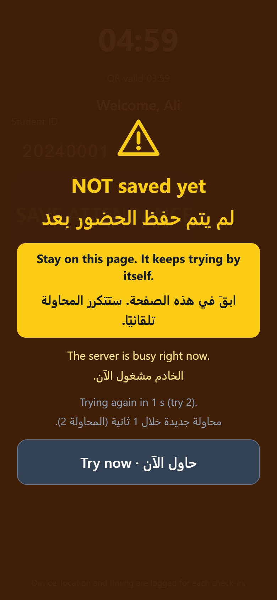
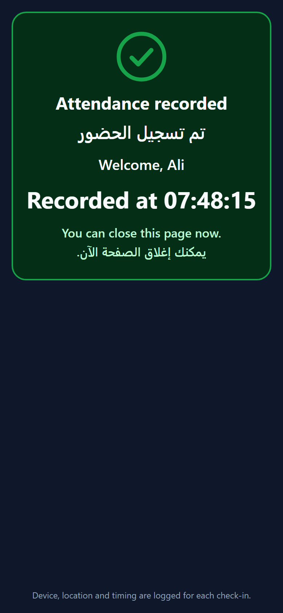
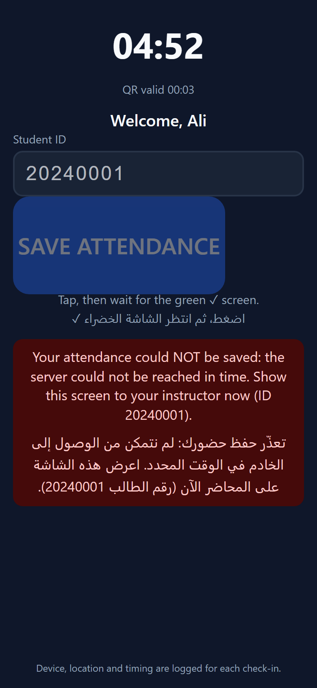
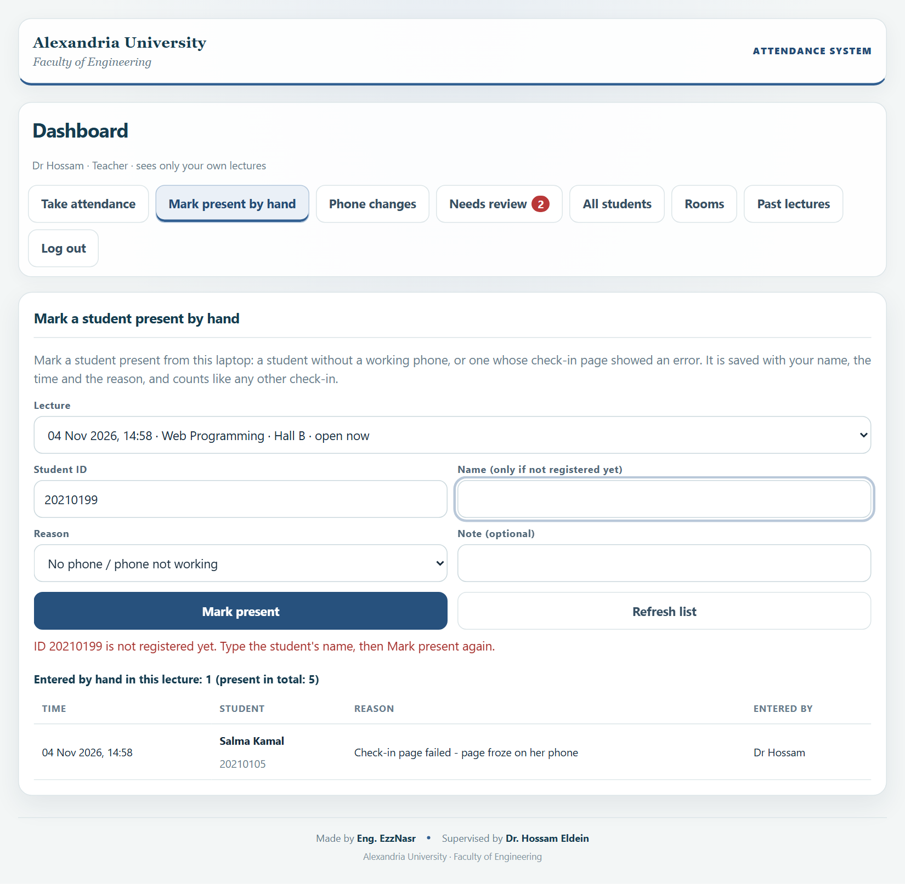
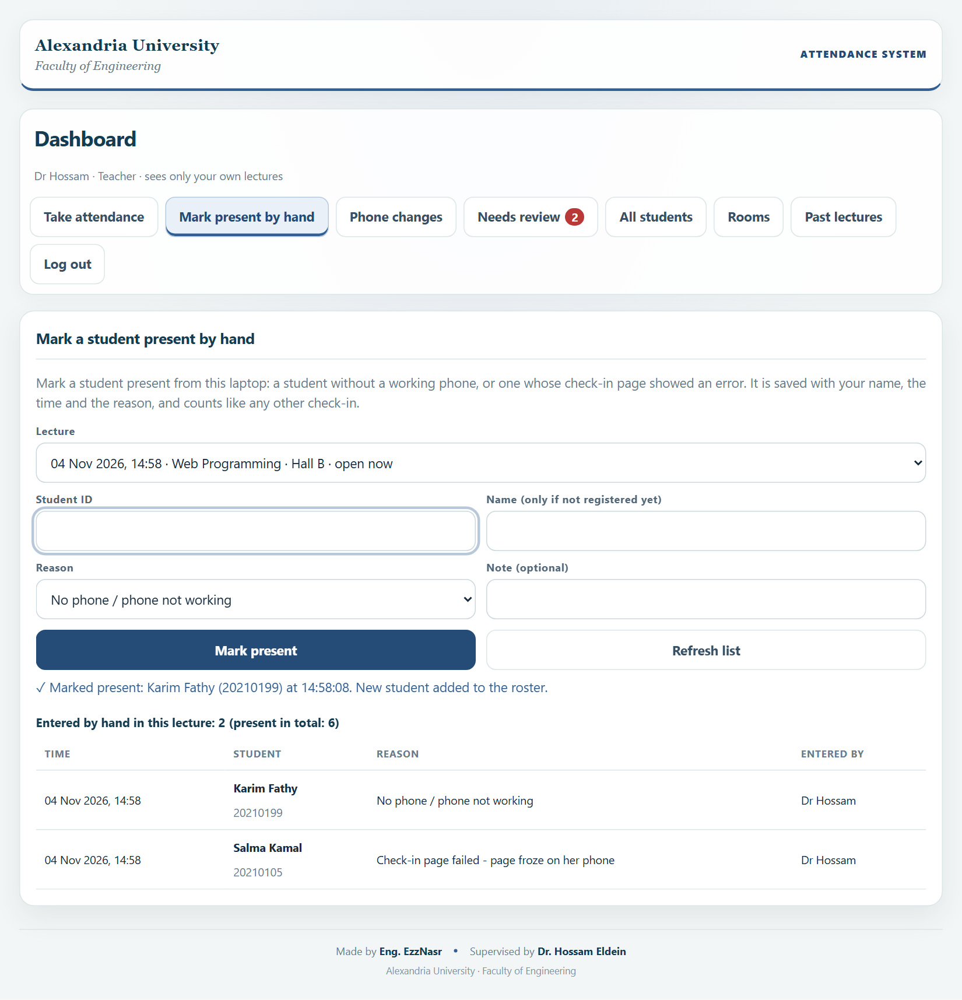

# Attendance page: what students see when they save

Phone size (390 x 844), captured 2026-11-04 from the real `attend/` page with a faked server (nothing reaches the live backend).
Decisions: D8 and D9 in [../decisions.md](../decisions.md).

Amber means **not saved yet, stay on the page**. Green means **saved, you can close it**.

| # | State | Screenshot |
|---|---|---|
| 1 | Before tapping: "Tap, then wait for the green screen" |  |
| 2 | Saving: spinner + "Don't close this page" |  |
| 3 | NOT saved yet: server busy, retrying by itself |  |
| 4 | Saved: green panel, "You can close this page now" |  |
| 5 | Could not save in time: show the instructor |  |

## Instructor dashboard: Manual entry tab (D9)

Captured from the real `attend/admin/` page against the real backend code (emulated).

| # | State | Screenshot |
|---|---|---|
| 6 | An ID that is not registered yet: asks for the name |  |
| 7 | Marked present: the list shows who, why and who entered it |  |

To redo them after a change to the page (needs Python Playwright):

```bash
python docs/attendance/screenshots/capture.py docs/attendance/screenshots
```
