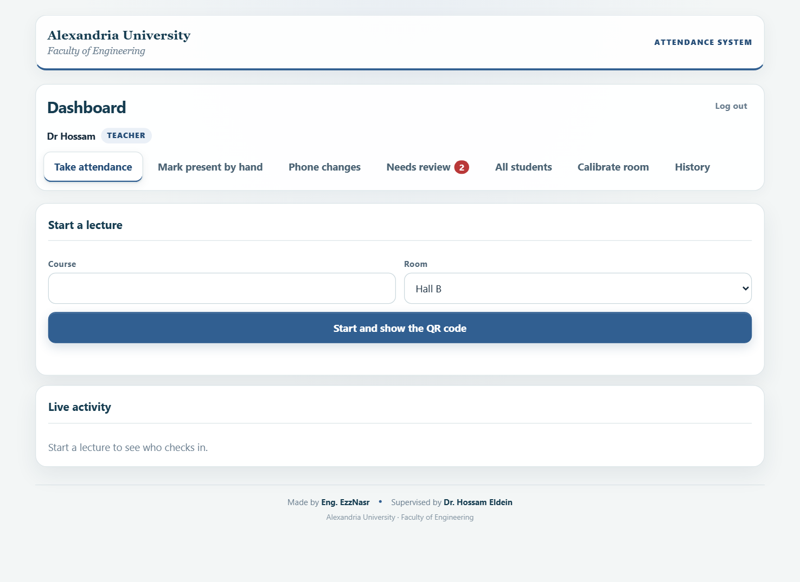
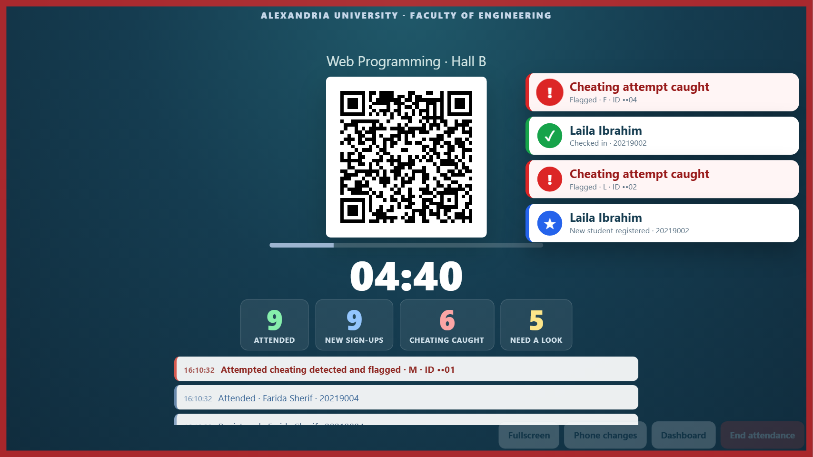
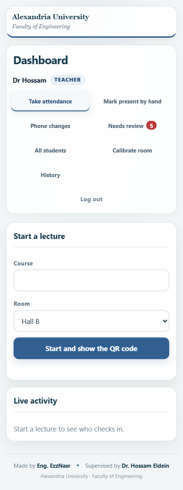
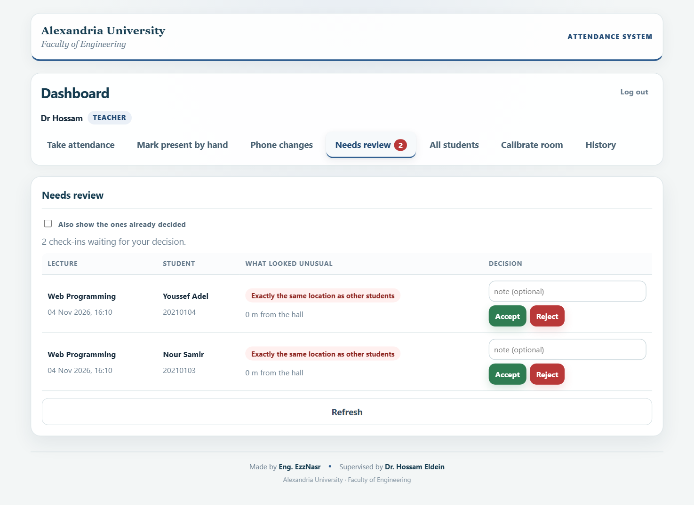
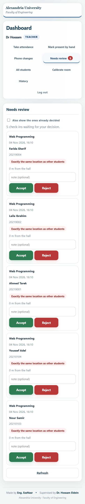
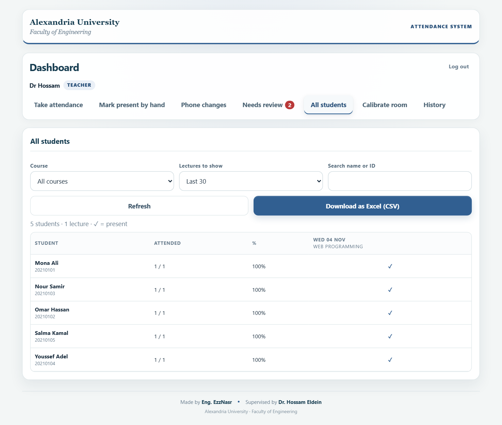
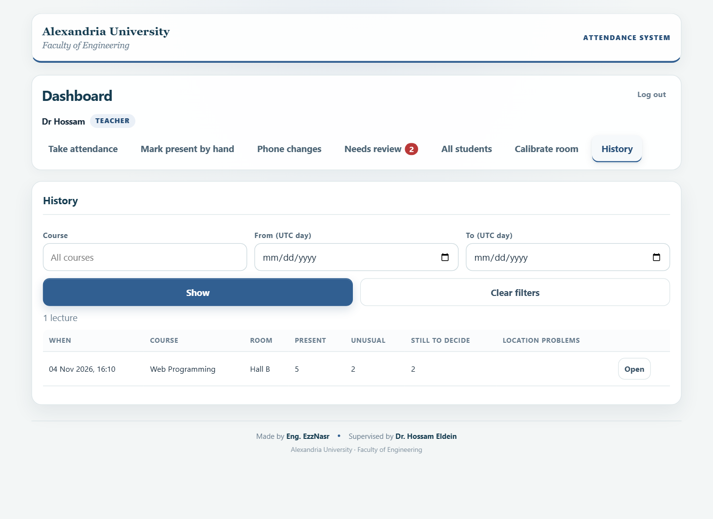
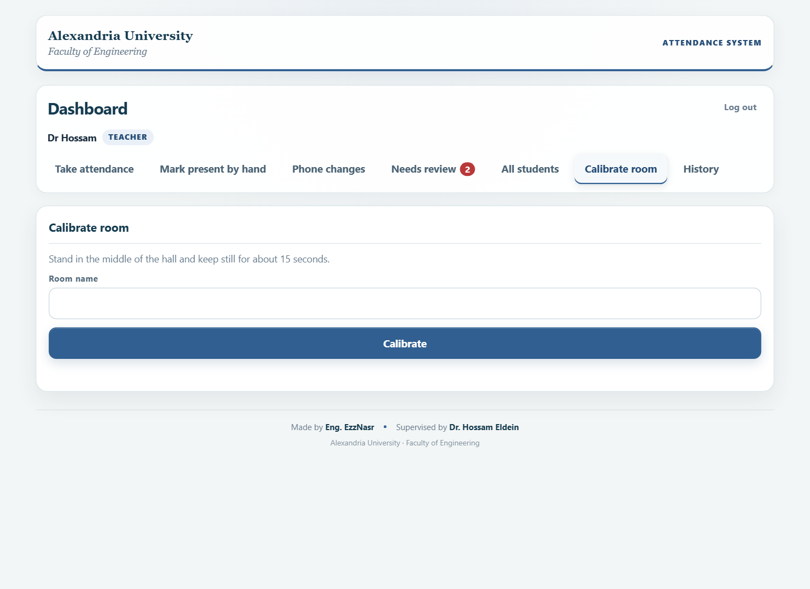

# Attendance: screenshots

Captured 2026-11-04 (after the polish pass, D13) from the real pages: the student page with a faked server, the dashboard
against the real `AttendanceAll.gs` on the emulated backend. Nothing reaches the live system; all names are sample data.
Decisions: D8, D9, D10, D13 and D14 in [../decisions.md](../decisions.md).

## Student page (phone, 390 x 844)

Amber means **not saved yet, stay on the page**. Green means **saved, you can close it** (the check mark draws itself as it lands).

| # | State | Screenshot |
|---|---|---|
| 1 | Before tapping: "Tap, then wait for the green screen" |  |
| 2 | Saving: spinner + "Don't close this page" |  |
| 3 | NOT saved yet: server busy, retrying by itself |  |
| 4 | Saved: green panel, "You can close this page now" |  |
| 5 | Could not save in time: show the instructor |  |

## Teacher dashboard

Tabs: Take attendance, Mark present by hand, Phone changes, Needs review, All students, Calibrate room, History
(plus All teachers and Teacher accounts for the admin).

| # | Screen | Screenshot |
|---|---|---|
| 8 | Take attendance (the name and role chip at the top, Log out in the corner) |  |
| 14 | The QR screen on a projector while students arrive: counters counting up, a card per arrival (red for cheating, with a red edge flash) |  |
| 15 | The same on a phone: counters in a 2 x 2 grid, cards under them, controls in a bar at the bottom |  |
| 16 | The dashboard on a phone |  |
| 6 | Mark present by hand: an ID that is not registered yet asks for the name |  |
| 7 | Mark present by hand: saved (green status pill) and listed with who, why and who entered it |  |
| 9 | Needs review: unusual check-ins in plain words, Accept (green) / Reject (red) with a note |  |
| 10 | Needs review on a phone: each check-in becomes a card |  |
| 11 | All students: everyone against every lecture, with attendance % |  |
| 12 | History: past lectures with their counts |  |
| 13 | Calibrate room |  |

## Redo them after a change (needs node and Python Playwright)

```bash
python docs/attendance/screenshots/capture.py docs/attendance/screenshots
```

```bash
python docs/attendance/screenshots/capture_dashboard.py docs/attendance/screenshots
```

Update this table in the same commit as the UI change.
