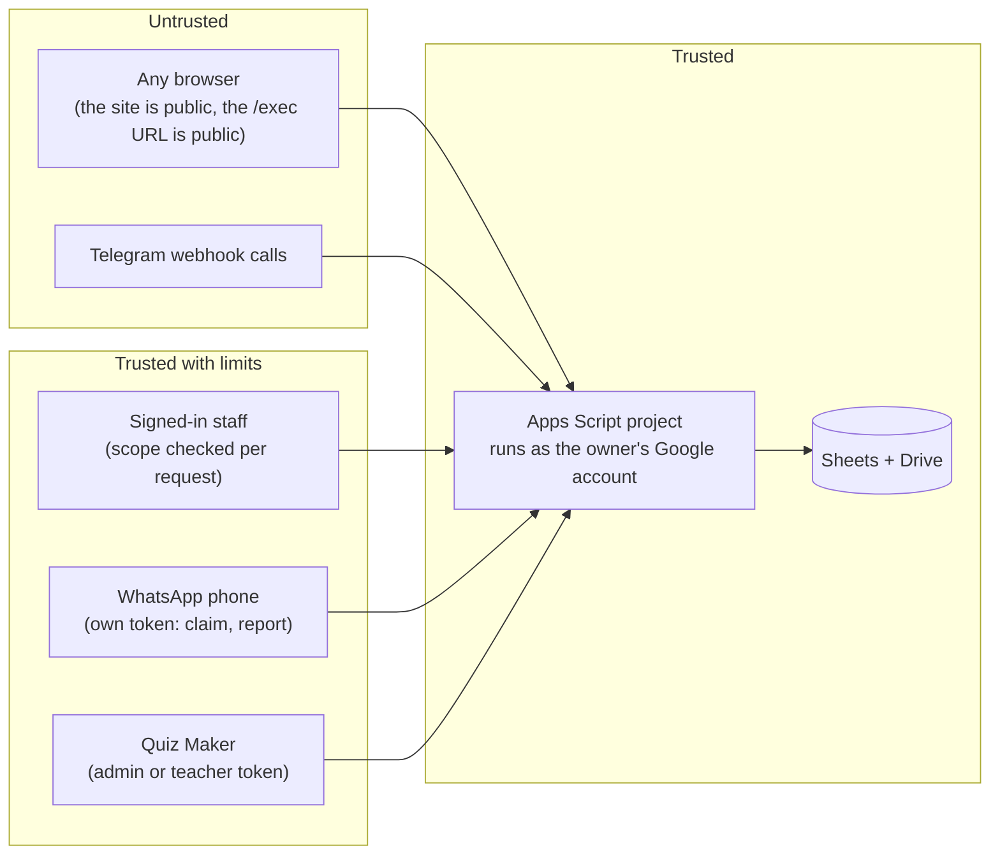

# Security model

*Written 2026-11-16. Part of the [handoff guide](README.md). This page describes how security is **designed** and names
the risk areas in general terms. The repo is public, so the list of open vulnerabilities, with evidence and fixes, is
kept outside it: `Docs/02-plans/active/engineering-handoff/SECURITY-REVIEW.md` (ask the owner).*

## 1. What is protected

| Asset | Where | Who may see it |
|---|---|---|
| Student records: name, phone, parent phone, year | `Students` tab | owner; a teacher for his own students |
| Results, homework, handwritten photos | `QuizResults`, `Submissions`, `WrittenAnswers`, Drive | the student; staff in scope |
| Paid content: video URLs, quiz answers | `Videos`, `QuizContent` | students with access; staff in scope |
| Payments and revenue | `Payments`, `Entitlements` | owner; a teacher for his subjects (no revenue) |
| Attendance records with location | attendance spreadsheet | the lecture's teacher; attendance admin |
| Secrets | Script Properties, the phone's `config.json`, the Quiz Maker's local config | owner |

## 2. Trust boundaries

Everything in the browser is untrusted: page scripts, `localStorage`, `staff-guard.js` and `?mock=1` are convenience,
never a control. Every rule is enforced again in the backend.

## 3. Controls that exist today

| Control | Where |
|---|---|
| Identity only from the token or session in the request, never from another payload field | `p4_ctx`, `_requireStudentSession`, `att_auth_` |
| Deny by default for scoped staff; one table of actions; response filters that fail closed | `P4_ACTIONS`, `p4_gate`, `p4_filter` |
| Assistants limited to an allow-list | `P3_STAFF_ALLOW`, `P4_ASSISTANT_DENY` |
| The owner flag is set only by hand in the sheet, never by an action | `is_admin` column |
| Login and reset throttles | `_reserveLoginAttempt`, `handleResetPassword`, `att_loginFail_` |
| One active sign-in per student account | `handleLoginStudent`, `check_session` |
| Teacher tokens stored as hashes, compared in constant time | `p4_findTeacherToken_`, `p4_safeEq_` |
| Attendance: signed tickets and tokens (HMAC), generated teacher passwords, 12 h expiry | `att_makeTicket_`, `att_userTokenMake_` |
| Webhooks: secret in the URL + sender allow-list + each update handled once | `handleTelegramUpdate`, attendance equivalent |
| The phone has its own narrow token | `WA_SENDER_TOKEN` |
| Sheet cells written as plain text (no formula injection, phones keep their zero) | `PLAIN_TEXT_HEADERS`, `_appendByHeader` |
| Server strings rendered as text on the newer pages; tested | `textContent` rule, ARCHITECTURE.md rule 16 |
| File delete limited to the attachments folder; photos never shared publicly | `handleDeleteAttachment`, `get_written_image` |
| Audit log for grants, revokes, grades and edits | `p2_audit`, `StudentEditLog` |
| Idempotent writes and upload size limits on photos | `client_id` dedupe, `P2_C_MAX_IMAGE_BYTES` |
| Weekly backups | `weeklyBackup` |

## 4. Risk areas (summary only)

Ordered by how much they matter. Details, evidence and fixes are in the private review.

| Area | Summary | Planned direction |
|---|---|---|
| Credentials | Password handling and long-lived secrets predate the current design standards | Server-side salted hashing with silent upgrade on login; rotate and scope long-lived tokens |
| Sessions | Sessions have no time limit and no "sign out everywhere" | Issue time on tokens, expiry, rotation |
| Account recovery | Recovery relies on knowledge, not possession | Staff-assisted or out-of-band recovery |
| Legacy compatibility paths | Some old client behaviour is still accepted behind switches | Close the switches after confirming no old clients remain |
| Content rendering | A few older pages render authored or submitted content with less strict rules than the newer pages | One shared safe renderer; a Content-Security-Policy |
| Client-trusted results | Some results are computed in the browser unless a switch is on | Server-side marking everywhere |
| Abuse and availability | A public endpoint with platform quotas and shared throttles | Per-account limits, cheaper public reads, split attendance into its own project |
| Deploy integrity | The backend is deployed by hand and has drifted from the repo before | Scripted deploy with a recorded source commit, verified after deploy |
| Privacy | Minors' personal data and locations, with no written retention rule | Privacy note, retention and deletion procedure, a dedicated Google account |
| Supply chain | Unpinned CI dependencies; an unofficial WhatsApp library on the phone | Lockfiles, pinned actions, update policy |

## 5. Rules for new code

1. Start every handler with the right `_require*` call; add the action to `P4_ACTIONS`; write a test per role.
2. Never read identity from the payload except `token`, or `student_id` + `session_token`.
3. Validate and bound every input (type, length, allowed values); refuse unknown lesson keys.
4. Render server data with `textContent`. If HTML is truly needed, pass it through one shared sanitizer.
5. No secret in the repo, in a URL that gets logged, in Telegram, or in test fixtures. Use Script Properties.
6. Anything that writes is idempotent on a client-supplied key and records an audit row.
7. New risky behaviour ships behind a switch that is off, with a rollback line in the deploy record.
8. Found a vulnerability? Do not open a public issue or commit a description: tell the owner and add it to the private
   review.
