# System diagrams

*Written 2026-11-16 from the code at `32436a7`. GitHub renders the Mermaid blocks. Part of the
[handoff guide](README.md).*

Contents: [1 Context](#1-context-who-uses-what) · [2 Parts and deploys](#2-parts-and-how-each-one-goes-live) ·
[3 Repo map](#3-repo-map) · [4 Request flow](#4-one-request-through-the-backend) ·
[5 Identity](#5-identity-and-roles) · [6 Data model](#6-data-model) · [7 Sequences](#7-main-sequences) ·
[8 Build and generated files](#8-what-generates-what) · [9 Test layers](#9-test-layers)

## 1. Context: who uses what

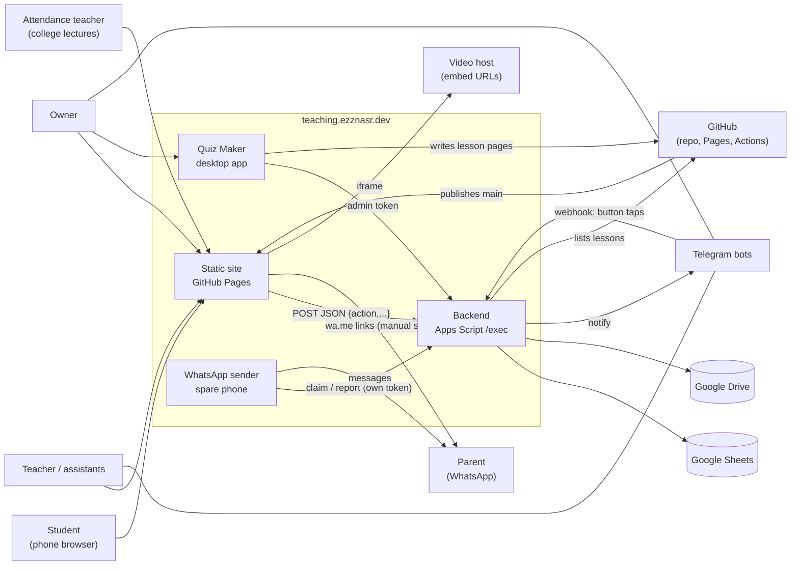

## 2. Parts and how each one goes live

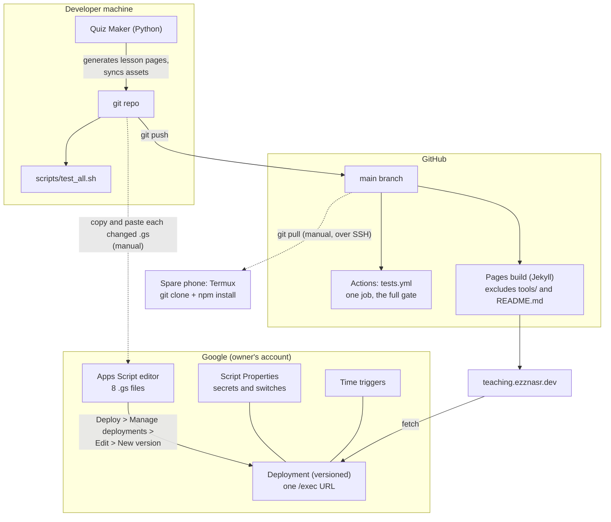

Rules that follow from this picture:

- **Backend first, then the site.** An old page on a new backend works (changes are additive); a new page on an old
  backend gets `Unknown action`.
- **Never "New deployment"**: it creates a new URL, and the URL is written into six site files and the phone's config.
- Pages publishes whatever is on `main` whether or not CI is green, unless branch protection stops the push.
- Rollback: the site by `git revert` + push; the backend by picking the previous version in *Manage deployments*
  (each deploy and its rollback version is recorded in `docs/attendance/decisions.md`).

## 3. Repo map

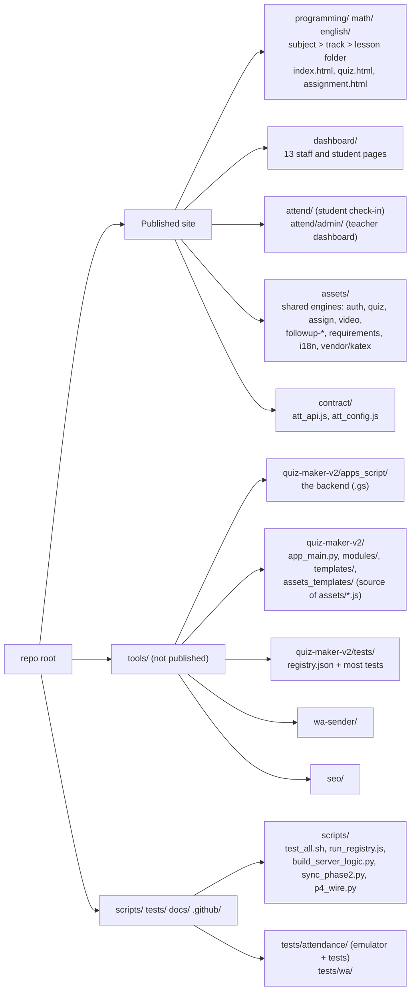

| Backend file | Lines | Owns |
|---|---:|---|
| `Code.gs` | 10,374 | Router (`doPost`), accounts, uploads, videos, access and payments, groups, quiz gate and content, follow-up v1, maintenance tools, and the merged Phase 2 / 3 / 4 sections |
| `AttendanceAll.gs` | 2,151 | Attendance: tickets, sign-up, check-in, flags, sessions, rooms, teacher accounts, its own Telegram bot, self-tests and load tests |
| `FollowupLogic.gs` | 1,020 | **Generated** event engine (when is each follow-up step due) |
| `Requirements.gs` | 615 | Requirements catalogue, per-group overrides, month lessons |
| `FollowupNotify.gs` | 456 | Hourly tick, Telegram reminders, snooze / done |
| `FollowupWhatsApp.gs` | 366 | WhatsApp outbox: enqueue, claim, report, modes, watchdog |
| `Revenue.gs` | 236 | Revenue report, lesson price |
| `FollowupRouter.gs` | 180 | Routes `admin_fu2_*` and `admin_req_*` |

## 4. One request through the backend

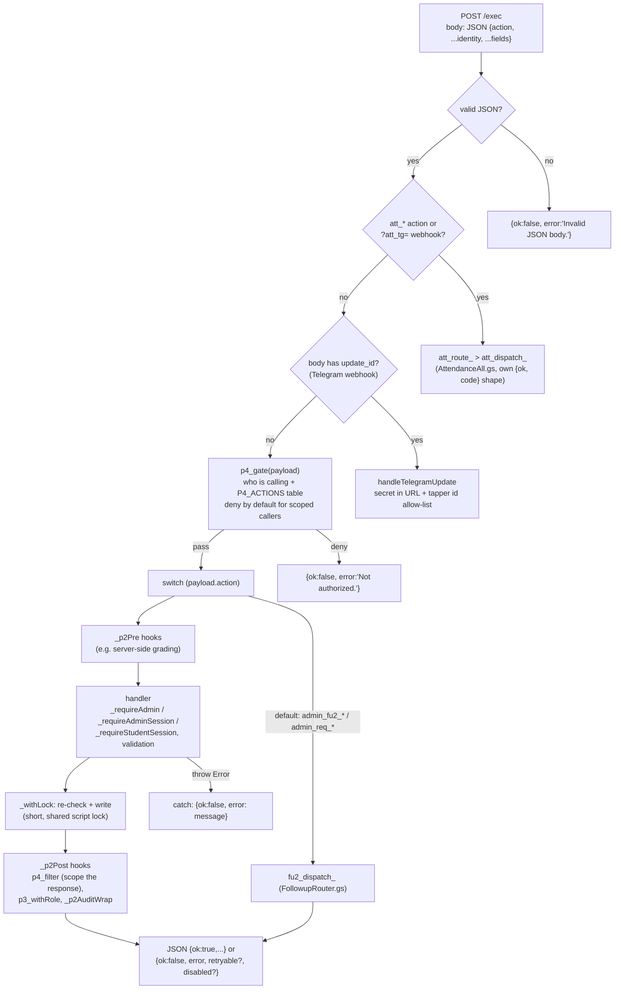

Notes:

- The site sends `Content-Type: text/plain` so the browser makes no CORS preflight (Apps Script cannot answer one).
- A busy lock throws an error marked `retryable`; clients resend the **same** record and the server de-duplicates on
  the record's `client_id` / dedupe key.
- `doGet` is only a health check.
- Old code throws error **text**; attendance returns error **codes**. New code should return codes
  ([ARCHITECTURE.md](../ARCHITECTURE.md) section 2).

## 5. Identity and roles

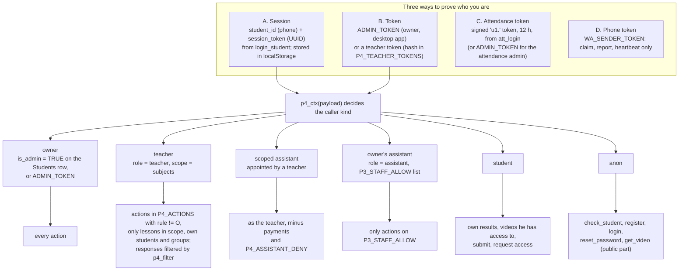

| Page | Owner | Teacher | Teacher's assistant | Owner's assistant |
|---|:-:|:-:|:-:|:-:|
| Results, lesson access | yes | own subjects | own teacher's subjects, no payments | |
| Follow-up, student summary, grading | yes | own students | own teacher's students | yes |
| Requirements | yes | | | yes |
| Team, revenue, teacher stats, wrong questions | yes | | | |
| My team | | yes | | |

The page (`assets/staff-guard.js`) only hides what a role cannot use. The server decides again on every request.

## 6. Data model

Google Sheets tabs. Two spreadsheets for the portal (`STUDENTS_SHEET_ID`, and optionally `DATA_SHEET_ID` for the large
tabs) and one for attendance (`ATT_SHEET_ID`). Tabs are created on first use. Keys are text; there are no enforced
foreign keys, so the relations below are conventions held by the code.

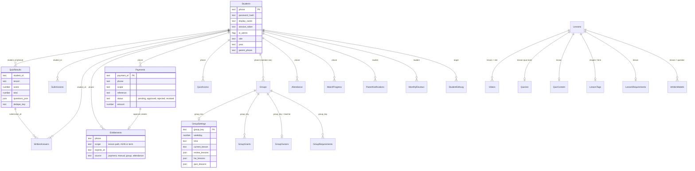

Other portal tabs: `AuditLog` (who changed what), `FollowupTemplates`, `RequirementChecks`, `MonthLessons`,
`TeacherTelegram`, `WaOutbox`.

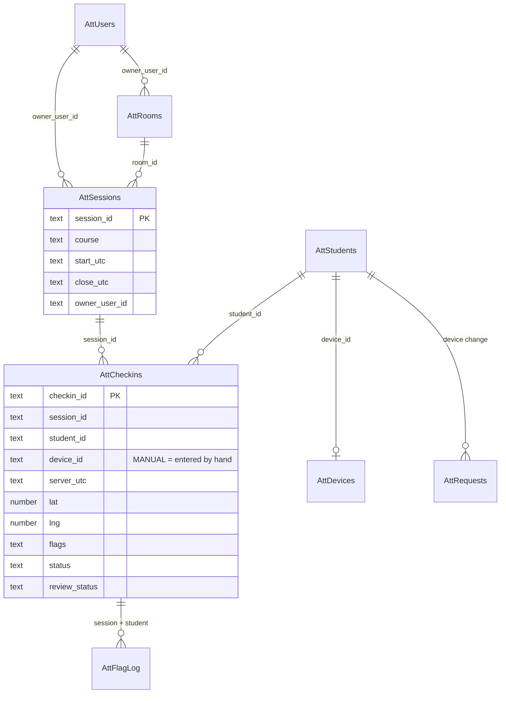

Files in Drive: lesson attachments (`ATTACHMENTS_FOLDER_ID`, link-viewable), homework files and result JSON
(`SUBMISSIONS_FOLDER_ID`), handwritten-answer photos (`WRITTEN_FOLDER_ID`, private, served only through
`get_written_image`), weekly backups (`BACKUPS_FOLDER_ID`).

## 7. Main sequences

### 7.1 Sign in

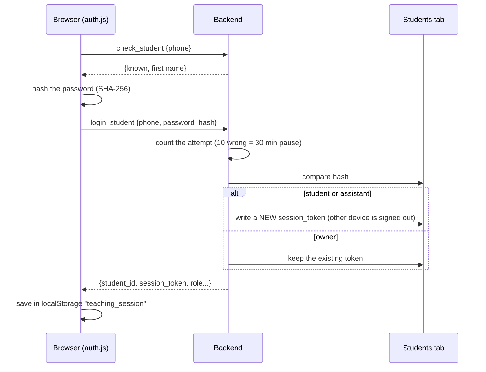

### 7.2 Pay for a lesson and get the video

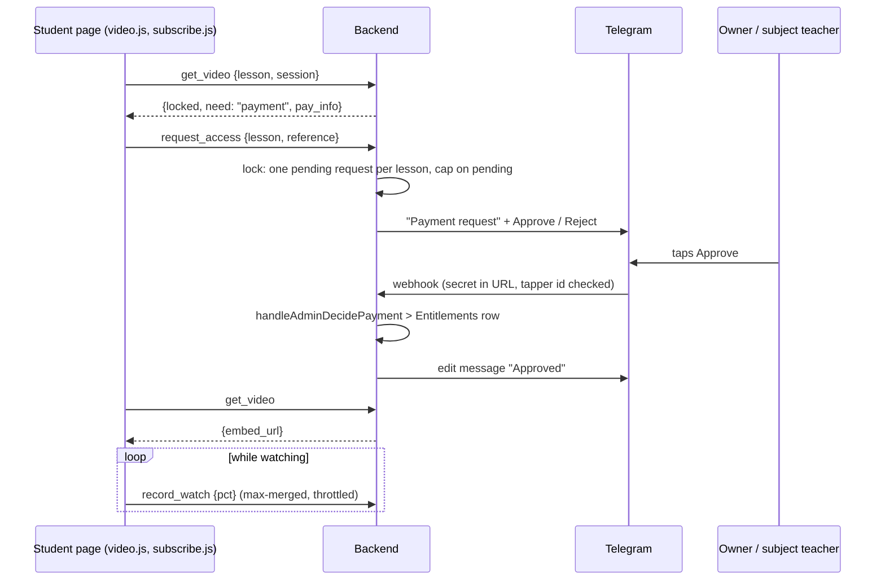

### 7.3 Take a quiz with a handwritten answer

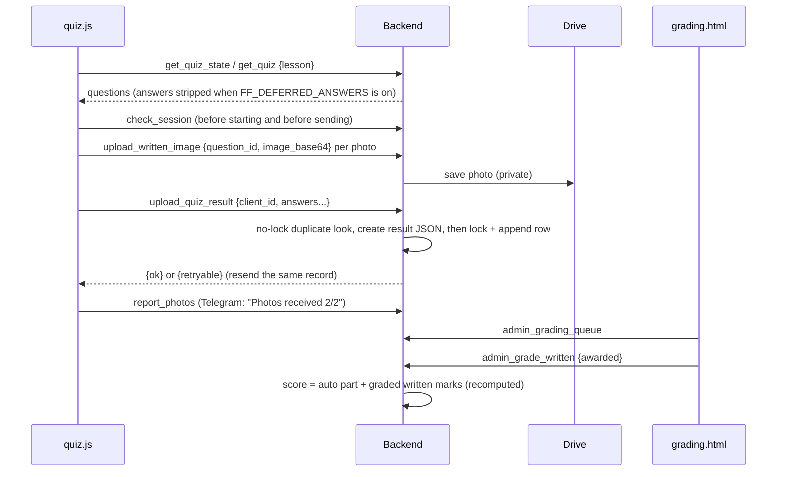

### 7.4 Attendance check-in

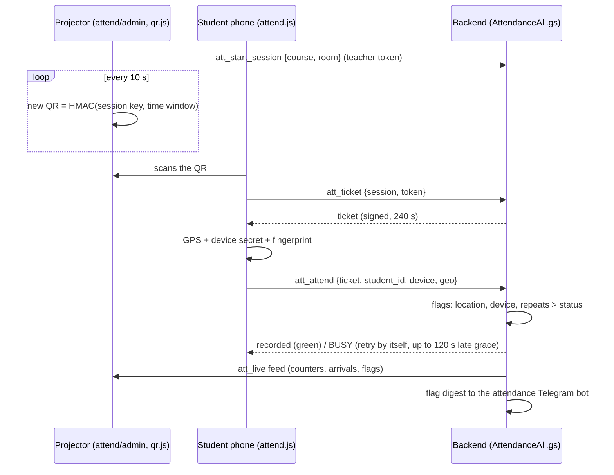

### 7.5 WhatsApp batch to parents

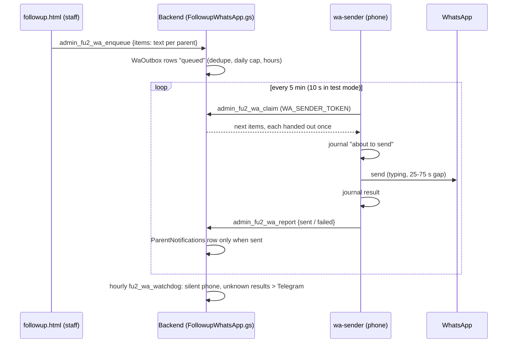

### 7.6 Hourly follow-up tick

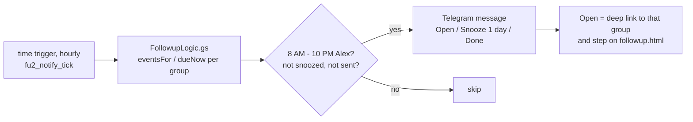

## 8. What generates what

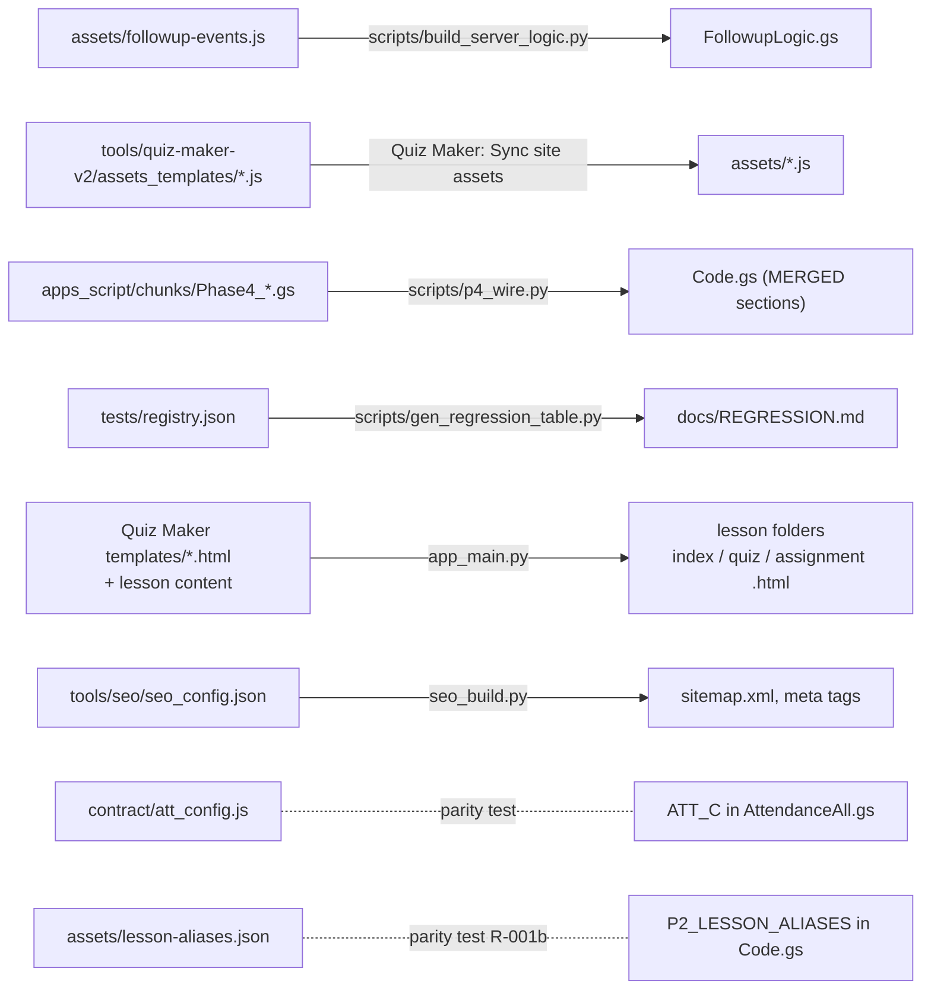

Solid arrows are generators (edit the left side only). Dotted lines are pairs kept equal by a test.

## 9. Test layers

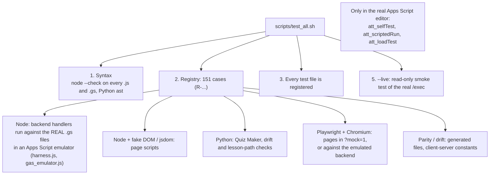
