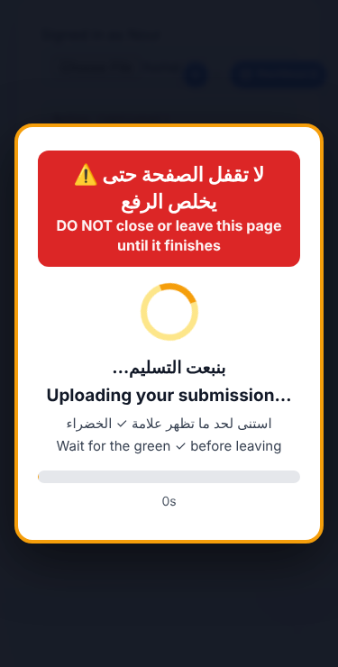
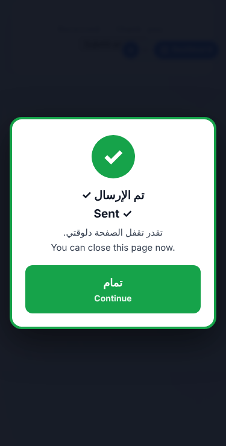
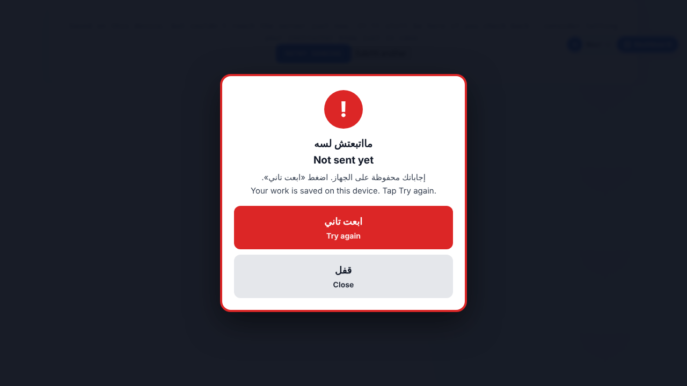
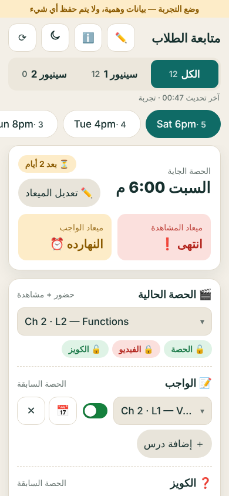
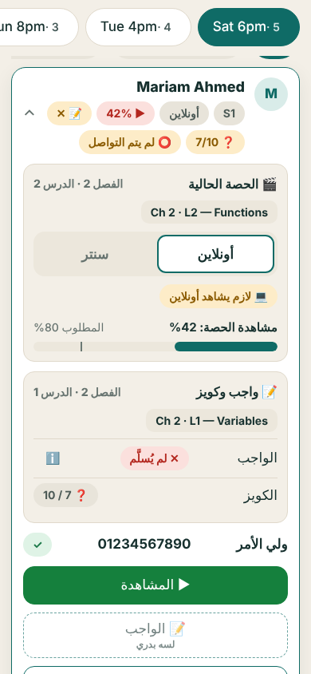

# Upload screen + assistant role — what changed

## 1. "Do not close this page" upload screen
Full-screen, bilingual (AR/EN), unmissable. Covers the page so nothing underneath can be tapped.
- Red banner: لا تقفل الصفحة حتى يخلص الرفع / DO NOT close or leave this page until it finishes
- Spinner, real progress bar ("photo 2 of 3"), seconds counter, "slow connection" / "server busy" notes
- Browser warns if the tab is closed or reloaded while uploading; phone kept awake where supported
- Ends on a green screen ("you can close this page now"); student must press Continue
- If it fails: red screen, answers are saved on the device, **Try again** button
- Covers: quiz photos, homework photos, file uploads, text/link homework, classic quiz

| Uploading | Done | Failed |
|---|---|---|
|  |  |  |

Files: `assets/upload-guard.js` (new, mirrored in `assets_templates/`), `assign.js`, `quiz.js` (hooked in). If the script cannot load, uploads work exactly as before.

## 2. Assistant role (verified)
An assistant is a normal student with `role = assistant`. She can use follow-up, student summary and grading only.
- See each student's exact gaps (missing homework, absent quiz, watch % vs required), message buttons
- Mark contacted per student/issue, and the group "parents contacted" switch
- Student summary + monthly report; written answers, photos, grading
- Refused on everything else (groups, access, payments, roles)

| Follow-up list | Student card: what is missing |
|---|---|
|  |  |

## 3. Before it works live
1. Apps Script: run `p3_setup_enable_followup_flags()` once (FF_PARENT_LOG, FF_MONTHLY, FF_GRADING).
2. Add her phone on `team.html`.
3. Commit + push; Quiz Maker "Sync site assets" keeps `upload-guard.js`.
Note: an assistant's first device is signed out when she logs in elsewhere.

## 4. Tests
- New: `test_p3_assistant_flow.js` (32), `e2e_upload_guard.py` (10); `e2e_capture.py` extended (40 total)
- Harness fixed (attendance hook stub) — ~40 cases that failed only for that reason now pass
- 7 older cases (R-A01..A04, R-P3-F1/B1/R1) still fail: they look for .gs files at old paths
