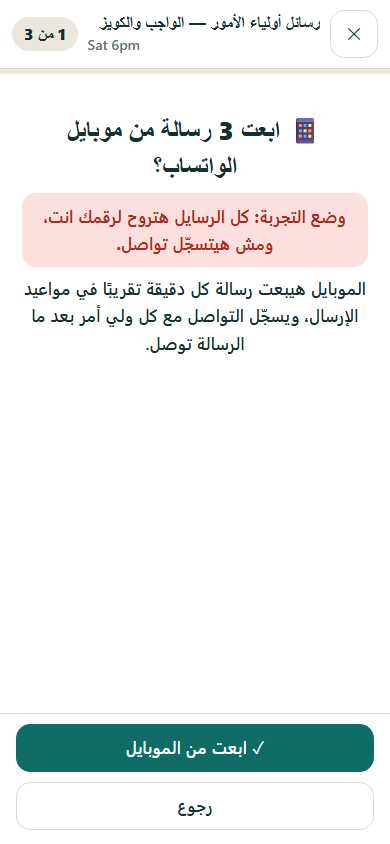
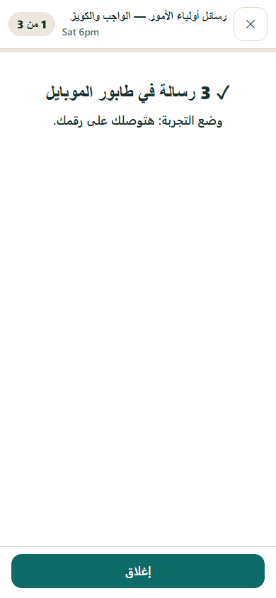

# WhatsApp sender (the spare phone)

*Built 2026-11-05. Status: **code done and tested, not live.** Nothing is sent until you set up the phone and switch the mode
on yourself (section 4). The original plan is in the external `Docs/02-plans/active/whatsapp-automation/` (PDF).*

## 1. What it does

On the follow-up page, the parent-message walk-through gets one new button on its first screen:
**📱 ابعت الكل من موبايل الواتساب (N)**. One tap queues every parent message of that step (exactly the text the page
composed, including any you edited) on the server. A spare Android phone at home, logged in to WhatsApp with the spare SIM,
picks the messages up and sends them slowly from its own number. Each parent is logged as contacted **only when the phone
reports that WhatsApp accepted the message** (the same contact-log entry the "I sent it" button writes).

Students whose parent number needs checking (missing, too short, the student's own number, not an Egyptian mobile) are left in
the normal one-by-one walk for you.

  

## 2. Decisions (2026-11-05)

| # | Decision | Why |
|---|---|---|
| W1 | **Sender = the Huawei Y7 Prime 2019 at home**, Termux + Node + Baileys, on home Wi-Fi and the charger. | A home connection is a stable residential IP: the biggest ban signal in the plan (a new data-centre IP every run, GitHub Actions) is gone. No monthly cost, no server. The phone has 3 GB RAM and Android 8.1/9: Termux needs Android 7+, Baileys uses about 100-200 MB. |
| W2 | **Phase 1 = one tap per batch, not zero taps.** The page composes, the server queues, the phone sends. | Recreating the page's per-student message logic on the server would duplicate a large piece of UI code; any mismatch would send wrong text to real parents. One tap per batch removes the per-parent taps, keeps the exact text the page already shows, and keeps a person looking at the list before it goes out. |
| W3 | **Phase 2 (later) = zero taps:** move the message composition to the server (like `FollowupLogic.gs` is generated from the browser logic), then let the hourly tick queue the due messages itself. | Only after phase 1 has run cleanly for a few weeks. See section 7. |
| W4 | **Off by default, test mode first.** `WA_MODE` = off / test / live. In test every message goes to **your** number with a `[TEST] → name · number` header, and nothing is logged as contacted. | You see exactly what parents would get before any parent gets anything. |
| W5 | **Never send twice.** The server hands each message out once; the phone writes a journal to disk before and after each send. A message whose result is unknown (phone died mid-send) is never re-sent: it becomes "unknown" and Telegram tells you to check the chat. | A duplicate message to a parent is worse than a late one. |
| W6 | **The server sets the pace:** sending hours 9:00-21:00 (Alex), a daily cap (60, **start with 20**), a random 25-75 s gap, a short "typing..." before each message. | Low, human-like volume to people who know the number is what keeps unofficial WhatsApp use from being banned. |
| W7 | **The phone has its own token** (`WA_SENDER_TOKEN`), never the admin token. It can only claim, report and say "alive". | A lost phone cannot read or change anything else. |
| W8 | **Telegram tells you about problems only:** a message that failed, a message with no report, the phone logged out, the phone silent for 90 minutes while messages wait. | You hear about errors, not about every send. |
| W9 | **Not deployed while you were away.** The code is in the repo and tested; the Apps Script part is switched off and inert until you add it (section 4). | Linking the phone needs you anyway, and an unattended deploy has nobody to notice a problem. |

## 3. How it fits together

```
follow-up page (your browser)            Apps Script (/exec)                      spare phone (Termux)
  walk-through → "send all" ──enqueue──▶  WaOutbox sheet  ◀──claim── every few min ── wa-sender (Node + Baileys)
                                           (queued → sending → sent)  ──items──▶     sends one by one, slowly
                                           ParentNotifications  ◀──report── sent / failed
  Telegram ◀── alerts (failed, unknown, logged out, silent phone) ── hourly fu2_wa_watchdog
```

| Part | File |
|---|---|
| Server outbox, modes, limits, alerts | `tools/quiz-maker-v2/apps_script/FollowupWhatsApp.gs` (routed by `FollowupRouter.gs`; no change to `Code.gs`) |
| Phone sender | `tools/wa-sender/` (`sender.js`, `pair.js`, `lib/loop.js`, `lib/journal.js`, `lib/api.js`, `lib/wa.js`, `termux/start-wa-sender.sh`) |
| Page button | `assets/followup-walk.js` (`phone` option), `assets/followup-app.js` (asks the server whether the phone is on) |
| Tests | R-WA-1 `tests/test_fu2_whatsapp.js` (server, 44), R-WA-2 `tests/wa/sender.test.js` (phone loop + end to end with the real server code, 30), R-WA-3 `tests/e2e_followup_wa_phone.py` (the button in Chromium, 18) |

**Not tested yet:** `lib/wa.js`, the thin adapter over Baileys, against real WhatsApp (it cannot run in CI). Test mode is how it gets
tested the first time (section 4, step 4).

## 4. Setting it up (about 45 minutes, once)

### A. Apps Script (on the computer)
1. In the Apps Script editor: **+ (Add file) > Script**, name it `FollowupWhatsApp`, paste `tools/quiz-maker-v2/apps_script/FollowupWhatsApp.gs`.
   Replace `FollowupRouter.gs` with the repo file (one word changed: `fu2_wa_routes_` added to the route list). Save.
2. Run **`fu2_wa_setup`**. The log shows the phone's token. Mode stays **off**.
3. Project Settings > Script Properties: add `WA_TEST_TO` = your own WhatsApp number with the country code (`2010xxxxxxxx`),
   and `WA_DAILY_CAP` = `20` for the first weeks.
4. Run **`fu2_wa_installTrigger`** (the hourly watchdog). Then **Deploy > Manage deployments > Edit > New version** (check every file
   against the repo first, see `docs/attendance/deploy.md`).

### B. The phone (Huawei Y7 Prime 2019)
1. Put the spare SIM in, install **WhatsApp** (or WhatsApp Business) and register the spare number. Send a "hello" to yourself.
2. Install **F-Droid** (f-droid.org), then from F-Droid install **Termux** and **Termux:Boot**. (Not the Play Store Termux: it is outdated.)
   Open Termux:Boot once.
3. EMUI battery settings, or Android will kill Termux at night:
   - Settings > Battery > **App launch** > Termux: switch to *Manage manually* and turn on **Auto-launch, Secondary launch, Run in background**. Same for Termux:Boot.
   - Settings > Apps > Termux > Battery: no "close after screen lock".
   - Open the recent-apps view and **lock** Termux (pull its card down / padlock).
   - Settings > Wi-Fi > advanced: keep Wi-Fi on during sleep: **Always**. Keep the phone on the charger.
4. In Termux:
   ```bash
   pkg update && pkg install -y nodejs-lts git
   git clone https://github.com/EzzNasr/teaching.ezznasr.dev.git ~/teaching.ezznasr.dev
   cd ~/teaching.ezznasr.dev/tools/wa-sender && npm install --omit=optional
   cp config.example.json config.json && nano config.json
   ```
   (Baileys pulls one part, `libsignal`, from GitHub. npm 12 refuses git downloads by default (`EALLOWGIT`). If you see
   that error, run `echo "allow-git=all" > .npmrc` in this folder and install again.)
   Fill in `api_url` (the `/exec` URL from `contract/att_config.js`), `wa_token` (from step A2) and `phone_number` (the spare number, `2010...`).
5. Link it: `npm run pair`. It prints an 8-character code. On the same phone: **WhatsApp > ⋮ > Linked devices > Link a device >
   Link with phone number instead**, type the code. When Termux says "Linked and connected", press Ctrl+C.
6. Start by itself. EMUI kills the whole of Termux now and then even with the battery settings above (seen on 2026-11-05,
   ~1 h after start, no reboot), so `termux/wa-up.sh` starts SSH and the sender only if they are not already running, and three
   things call it: phone boot (Termux:Boot), **opening the Termux app** (`~/.bashrc`), and a 15-minute watchdog.
   ```bash
   cp termux/wa-up.sh termux/start-wa-sender.sh ~/.termux/ && chmod +x ~/.termux/*.sh
   mkdir -p ~/.termux/boot && printf '#!/data/data/com.termux/files/usr/bin/sh\nsh ~/.termux/wa-up.sh boot\n' > ~/.termux/boot/00-wa-up.sh && chmod +x ~/.termux/boot/00-wa-up.sh
   echo 'sh ~/.termux/wa-up.sh opened >/dev/null 2>&1' >> ~/.bashrc
   ```
   Watchdog (needs the **Termux:API** app from the same place Termux came from, then `pkg install termux-api`):
   `termux-job-scheduler --job-id 1 --period-ms 900000 --persisted true --script ~/.termux/wa-up.sh`.
   Then reboot the phone. Check: `tail -f ~/teaching.ezznasr.dev/tools/wa-sender/data/sender.log` shows `WhatsApp connected` and `idle: off`.

### C. Test, then go live
1. Run **`fu2_wa_modeTest`** (needs the Script Property named exactly **`WA_TEST_TO`**). In test mode the phone looks for work every
   **10 seconds** and sends 5-10 s apart, so a batch starts within seconds; live keeps 5-minute checks and 25-75 s gaps. On the follow-up page open a parent-message step: the phone button appears. Send a batch.
   Every message arrives on **your** number with `[TEST] → name · number`. Check the text, the numbers and the pace.
2. Try the failure paths once: turn the phone's Wi-Fi off for 2 hours with something queued (Telegram: "phone is silent"), and
   queue a message to a number that has no WhatsApp (Telegram: "not sent").
3. When you are happy: **`fu2_wa_modeLive`**. Keep `WA_DAILY_CAP` at 20 for the first two weeks, then raise it.
4. **Emergency stop: `fu2_wa_modeOff`** (or set `WA_MODE` = off). The phone stops claiming within 10 minutes; queued messages stay
   queued and can be cancelled (`admin_fu2_wa_cancel`).

### D. The monthly report batch (added 2026-11-06)
The monthly review sheet has **📱 ابعت التقارير من موبايل الواتساب** (one group or all groups, counts first). A batch carries
`send_to`: **`"test"` is the default for the monthly report**, and a test batch stays test even while `WA_MODE` is live (the phone
still sends those rows to `WA_TEST_TO` with `[TEST]`, nothing is logged). `"parents"` only takes effect while live. A live monthly
message that the phone reports as delivered marks the student's month **sent**. Other events (`parents_watch`, `parents_hw`) keep
the old behaviour (the phone's mode). Details: `docs/specs/month-lessons.md`.

## 5. Keeping the number safe (ban risk)

- Only parents who know the teacher's team; ask them to **save the number** (a saved contact is the strongest trust signal).
- Low volume: start at 20 a day, never above about 60; the 25-75 s gap and sending hours are enforced by the server.
- Messages are personal (name, lesson, deadline), so no two are identical. Avoid links in the first weeks.
- If WhatsApp ever shows a warning or the number gets a temporary ban: `fu2_wa_modeOff`, wait a week, and go back to manual sending.
  The spare SIM means the number parents already know is never at risk.
- Baileys is pinned to 7.0.0-rc14 (2026-11-05: 6.7.16 could not link; 6.7.24 linked and sent, but every message showed "Waiting for this message" on the receiving phones because 6.7.x cannot address LID chats). lib/wa.js also answers resend requests (getMessage, data/sent-messages.json). When WhatsApp changes something and it breaks (the phone logs "closed" again and again), update
  it on purpose: change the version in `package.json`, `npm install`, test mode first.

## 6. Watching it

- Telegram alerts (W8). The follow-up page's contact state updates as messages are actually sent.
- `admin_fu2_wa_status` (the page asks it): mode, sent today, the cap, the phone's last sign of life, the last 30 messages.
- On the phone: `data/sender.log` (every send and error), `data/journal.json` (what it tried).
  The log has a line for every change ("idle: off", "idle: queue empty", "idle: outside sending hours"), so the last idle line is the current state.
- `npm run selftest` (sender stopped first) sends one message to the phone's own WhatsApp: it checks the WhatsApp side without the server or any parent.
- The `WaOutbox` sheet: one row per message with its status (`queued`, `sending`, `sent`, `failed`, `unknown`, `cancelled`) and the error.

## 7. Phase 2: zero taps (not built)

1. Generate the message composer for the server from `assets/followup-templates.js` (the way `scripts/build_server_logic.py`
   already generates `FollowupLogic.gs`), plus the per-student "which issues are due and not yet logged" rule that
   `followup-app.js` uses (`walkAction` / `logItems`).
2. A parity test: server text = page text for the golden scenarios.
3. In the hourly tick (`FollowupNotify.gs`), when `parents_watch` / `parents_hw` is due and the group has auto-send on, queue
   the messages through the same `fu2_wa_enqueue_` (the same checks, caps and dedupe).
4. A per-group switch on the page ("send automatically"), off by default.
